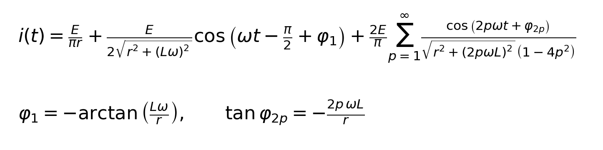
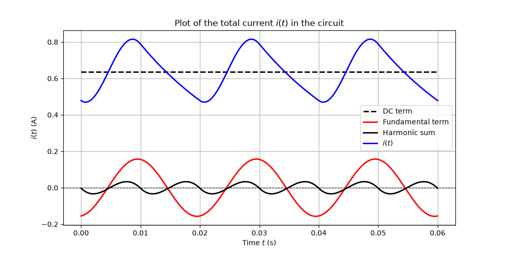
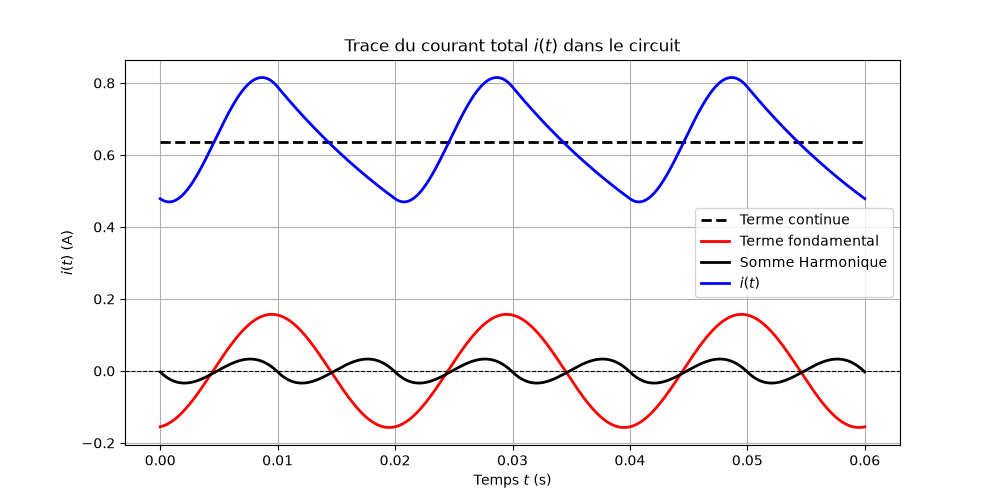

# Exercice
Recreate the function below using NumPy and plot it using MatPlot
> [!NOTE]
> This code was originaly made in French


**Credits:** CPGE Ibn Ghazi

> [!NOTE]
> The below explanation is drafted by AI, code is human made.

# Current in an R-L Circuit Fed by a Half-Wave Rectified Voltage

This script computes and plots the current i(t) in a series R-L circuit supplied by a half-wave rectified sinusoidal voltage, using a Fourier series decomposition.

## Signal processing idea

A half-wave rectified sine of amplitude E and angular frequency ω is periodic, so it can be written as a Fourier series: a DC term, a fundamental at ω, and harmonics at even multiples 2pω.

```
u(t) = E/π + (E/2)·sin(ωt) + (2E/π) · Σ cos(2pωt) / (1 − 4p²)      (p = 1, 2, 3, ...)
```

Because the circuit is linear, each component can be treated separately and the results summed (superposition). For each frequency component, the R-L circuit has an impedance:

```
|Z| = √(R² + (Lω_k)²)        phase shift: φ_k = −arctan(Lω_k / R)
```

The current is then the sum of three parts:

| Term | Frequency | Amplitude |
|------|-----------|-----------|
| DC term | 0 | E / (πR) |
| Fundamental | ω | E / (2·\|Z(ω)\|) |
| Harmonics | 2pω | (2E/π) / (\|Z(2pω)\| · \|1 − 4p²\|) |

The inductor acts as a low-pass filter: higher harmonics see a larger impedance and decay roughly as 1/p³, so only a few terms are needed for an accurate result.

## Parameters

| Symbol | Value | Meaning |
|--------|-------|---------|
| E | 10 V | Voltage amplitude |
| r | 5 Ω | Resistance |
| L | 0.1 H | Inductance |
| f | 50 Hz | Source frequency |

## Files
- `function.py`: the function plot script
- `original.py`: the original script (in French).
- `images/`: result plots.

## Results

Plot of the current i(t) with its DC term, fundamental and harmonic sum:



Plot from the original script:



## Usage

```bash
python original.py
```
```bash
python function.py
```

> [!TIP]
> The harmonic sum converges very quickly. Setting `N = 50` instead of `1000000` gives a visually identical plot almost instantly.