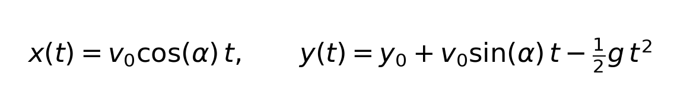
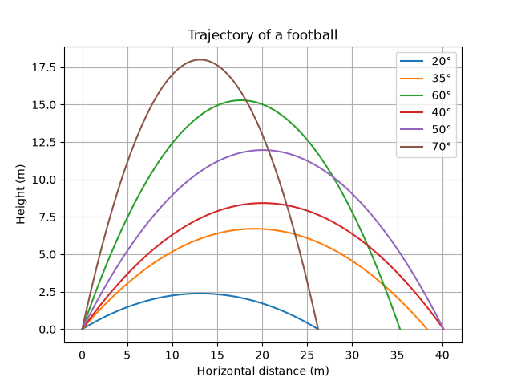
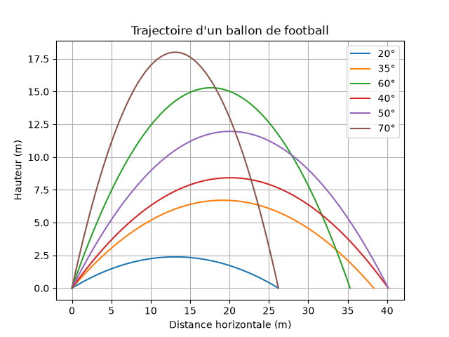

# Exercice
Trace the trajectory of a ball using NumPy and MatPlot
> [!NOTE]
> This code was originaly made in French



> [!NOTE]
> The below explanation is drafted by AI, code is human made.

# Trajectory of a Ball Launched at Several Angles

This script computes and plots the trajectory of a ball launched with the same initial speed at several angles, ignoring air resistance.

## Physics idea

With no drag, the horizontal and vertical motions are independent. Horizontally the velocity is constant, and vertically the ball undergoes uniform deceleration due to gravity:

```
x(t) = v₀·cos(α)·t
y(t) = y₀ + v₀·sin(α)·t − ½·g·t²
```

The flight ends when the ball returns to ground level. With y₀ = 0, this gives closed-form results:

| Quantity | Formula |
|----------|---------|
| Flight time | t_f = 2·v₀·sin(α) / g |
| Range | v₀²·sin(2α) / g |
| Maximum height | v₀²·sin²(α) / (2g) |

The script samples each trajectory at 100 time points between 0 and t_f. Range is read from the last x value and maximum height from the largest sampled y, so the height is very slightly approximate.

## Parameters

| Symbol | Value | Meaning |
|--------|-------|---------|
| v₀ | 20 m/s | Initial speed |
| g | 9.81 m/s² | Gravity |
| y₀ | 0 m | Initial height |
| α | 20°, 35°, 60°, 40°, 50°, 70° | Launch angles |

## Expected results

| Angle | Flight time | Range | Max height |
|-------|-------------|-------|------------|
| 20° | 1.39 s | 26.21 m | 2.39 m |
| 35° | 2.34 s | 38.32 m | 6.71 m |
| 60° | 3.53 s | 35.31 m | 15.29 m |
| 40° | 2.62 s | 40.16 m | 8.42 m |
| 50° | 3.13 s | 40.16 m | 11.96 m |
| 70° | 3.83 s | 26.21 m | 18.00 m |

## What to notice

- **Complementary angles give the same range.** 20° and 70° both land at 26.21 m, and 40° and 50° both land at 40.16 m, because sin(2α) = sin(180° − 2α). The steeper shot just flies higher and longer.
- **Maximum range is at 45°**, where sin(2α) = 1, giving about 40.77 m. That angle is not in the list, but 40° and 50° come close.
- **Height and flight time grow with angle**, since they depend on the vertical component v₀·sin(α).

## Files
- `function.py`: the function plot script
- `original.py`: the original script (in French).
- `images/`: result plots.

## Results

Plot of the current i(t) with its DC term, fundamental and harmonic sum:



Plot from the original script:



## Usage

```bash
python original.py
```
```bash
python function.py
```

> [!TIP]
> The harmonic sum converges very quickly. Setting `N = 50` instead of `1000000` gives a visually identical plot almost instantly.